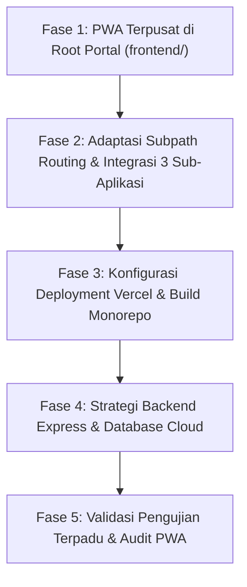

# Rencana Arsitektur & Implementasi: PWA Terpusat di Root + Deployment Vercel

> **Dokumen Spesifikasi & Rencana Kerja**
> **Proyek**: Ekosistem STIKes Budi Luhur Cimahi (Portal Utama + 3 Aplikasi Mandiri)
> **Arsitektur**: Single-Origin PWA Terpusat dengan Sub-App Module & Multi-Zone Vercel Deployment

---

## 1. Ringkasan Eksekutif & Konsep Utama

### Konsep PWA Terpusat (One PWA to Rule Them All)
Pengguna hanya memasang (**install**) **1 aplikasi PWA dari Web Portal Utama** (`/`). Di dalam aplikasi PWA terpasang tersebut:
1. **Portal Utama** bertindak sebagai *Home Launcher / Dashboard Hub*.
2. **Aplikasi 1 (FEMORY)**, **Aplikasi 2**, dan **Aplikasi 3 (PRELUNA)** bertindak sebagai **Menu / Modul Internal**.
3. Transisi antar-aplikasi terjadi di dalam **satu jendela aplikasi PWA yang sama** (tanpa membuka browser tab baru, tanpa URL bar safari/chrome yang muncul).
4. Di setiap sub-aplikasi tersedia tombol **"Kembali ke Portal"** untuk kembali ke hub utama secara instan.
5. **Isolasi Data & Sesi Tetap Terjaga**: Meskipun berada dalam satu domain PWA, token auth (`app1_auth_token`, `app2_auth_token`, `app3_auth_token`) dan database backend (`fe_tablet_app1`, `fe_tablet_app2`, `fe_tablet_app3`) tetap 100% independen dan terisolasi.

---

## 2. Struktur Fase Implementasi (5 Fase)

Rencana kerja ini dibagi menjadi **5 Fase Terarah**:



---

### FASE 1: PWA Terpusat di Root Portal (`frontend/`)
**Tujuan**: Menjadikan Root Portal Web sebagai satu-satunya entitas PWA yang dapat diinstal oleh user ke homescreen Android, iOS, maupun Desktop.

- [x] **1.1. Konfigurasi Web App Manifest di Root (`frontend/public/manifest.webmanifest`)**
  - Definisikan `scope: "/"` dan `start_url: "/"`.
  - Atur `display: "standalone"`, `orientation: "portrait-primary"`.
  - Berikan identitas resmi STIKes Budi Luhur: nama, deskripsi, warna tema (`theme_color: "#005EB8"`, `background_color: "#ffffff"`).
  - Daftarkan icon resolusi tinggi (192x192, 512x512, maskable icon untuk Android adaptive icons).
- [x] **1.2. Implementasi Service Worker Root (`frontend/public/sw.js`)**
  - Service worker beroperasi pada scope `/` agar dapat memantau dan meng-cache shell utama.
  - Implementasikan strategi caching *Stale-While-Revalidate* untuk aset statis dan *Network-First* untuk data dinamis.
  - Sediakan halaman offline fallback (*Offline Shell*) ramah pengguna (`frontend/public/offline.html`) jika perangkat kehilangan koneksi internet.
- [x] **1.3. UI PWA Install Prompt & Smart Banner (`frontend/src/components/PWAInstallPrompt.tsx`)**
  - Tangkap event `beforeinstallprompt` dari browser.
  - Tampilkan banner/tombol elegan: *"Pasang Aplikasi Kampus Budi Luhur di Layar Utama"*.
  - Sediakan panduan khusus untuk pengguna iOS Safari (*"Ketuk Bagikan lalu Pilih Tambahkan ke Layar Utama"*).
- [x] **1.4. Pembaruan Link Launcher di Portal (`frontend/src/config/apps.ts`)**
  - Ubah URL tujuan aplikasi agar mendukung mode path relatif produksi:
    - Mode Dev: `http://localhost:5173`, `http://localhost:5174`, `http://localhost:5175`.
    - Mode Prod / Vercel: `/app1/`, `/app2/`, `/app3/`.

---

### FASE 2: Adaptasi Subpath Routing & Integrasi 3 Sub-Aplikasi (`apps/app1, app2, app3`)
**Tujuan**: Memastikan ketiga aplikasi dapat berjalan mulus di subpath `/app1/`, `/app2/`, `/app3/` tanpa konflik PWA dan memiliki navigasi kembali ke Portal.

- [x] **2.1. Konfigurasi Dynamic Base URL di Vite (`vite.config.ts`)**
  - Konfigurasi opsi `base` di Vite masing-masing sub-aplikasi:
    ```ts
    base: process.env.VITE_BASE_PATH || '/',
    ```
  - Mode local dev tetap berjalan di root `localhost:517x/`, sementara saat build produksi menggunakan `/app1/`, `/app2/`, `/app3/`.
- [x] **2.2. Konfigurasi React Router `basename`**
  - Pastikan `<BrowserRouter>` di `apps/app1`, `apps/app2`, dan `apps/app3` menyertakan `basename={import.meta.env.BASE_URL}`.
  - Dengan ini, route `/auth/login` di App 3 otomatis menjadi `/app3/auth/login` tanpa mengubah logika internal route.
- [x] **2.3. Pembersihan Manifest & Service Worker Sub-Aplikasi**
  - Dinonaktifkan registrasi duplikat `ServiceWorkerRegister` di sub-aplikasi dan diselaraskan manifest ke root ecosystem manifest.
  - Hal ini krusial agar browser tidak bingung memiliki beberapa PWA manifest pada domain yang sama, sehingga Root PWA tetap memegang kontrol tunggal.
- [x] **2.4. Penambahan Komponen Navigasi "Kembali ke Portal" di Sub-Aplikasi**
  - Tambahkan tombol di header/navbar dan mobile menu pada `app1`, `app2`, dan `app3`:
    - Label: *"Portal"* (desktop pill) dan *"Kembali ke Portal Utama Budi Luhur"* (mobile menu).
    - Aksi: Navigasi ke `/` (Root Portal) dengan transisi mulus dalam PWA standalone window.

---

### FASE 3: Konfigurasi Deployment Vercel & Build Monorepo
**Tujuan**: Menggabungkan output build dari 4 proyek frontend ke dalam satu struktur distribusi yang siap dideploy ke Vercel dalam 1 project tunggal.

- [x] **3.1. Pipeline Script Build Monorepo (`package.json` & `scripts/build-vercel.js`)**
  - Dibuat script perakitan build otomatis `npm run build:vercel` (`scripts/build-vercel.js`).
  - Menjalankan build terisolasi: Portal, App 1 (`/app1/`), App 2 (`/app2/`), App 3 (`/app3/`).
  - Menyatukan output ke `dist/` terpadu dengan pembersihan service worker duplikat.
- [x] **3.2. Konfigurasi `vercel.json` Multi-SPA Rewrites**
  - Dibuat file `vercel.json` di root repositori dengan Multi-SPA rewrite rules (`/app1/:path*`, `/app2/:path*`, `/app3/:path*`, `/:path*`).
  - Dikonfigurasi header PWA `Cache-Control: no-cache, no-store, must-revalidate` dan `Service-Worker-Allowed: /` untuk `sw.js`.
  - Dikonfigurasi cache immutable jangka panjang untuk static assets dan icons.

---

### FASE 4: Strategi Backend Express & Database Cloud untuk Vercel (Neon Serverless Postgres)
**Tujuan**: Menyediakan integrasi backend Express Serverless di Vercel dan database cloud Neon PostgreSQL terisolasi.

- [x] **4.1. Serverless Function Handlers (`api/app1.ts`, `api/app2.ts`, `api/app3.ts`)**
  - Dibuat handler Vercel Serverless Function untuk masing-masing aplikasi yang secara otomatis memotong prefix `/api/appX` sehingga seluruh rute Express internal (`/api/v1/...`) bekerja tanpa perlu modifikasi kode.
  - Handler tervalidasi dan berhasil diimpor sebagai fungsi request listener standar Vercel Node.js.
- [x] **4.2. Routing API Rewrites di `vercel.json`**
  - Didaftarkan aturan rewrite reverse proxy serverless di `vercel.json`:
    - `/api/app1/:path*` $\rightarrow$ `/api/app1`
    - `/api/app2/:path*` $\rightarrow$ `/api/app2`
    - `/api/app3/:path*` $\rightarrow$ `/api/app3`
- [x] **4.3. Konfigurasi Client API Base URL Otomatis di Frontend**
  - Disesuaikan `API_BASE_URL` di `client.ts` ketiga aplikasi: otomatis menggunakan relative path `/api/app1/api/v1`, `/api/app2/api/v1`, `/api/app3/api/v1` saat build produksi Vercel (`import.meta.env.PROD`).
  - Zero-CORS dan bebas masalah domain silang.
- [x] **4.4. Isolasi Database Neon PostgreSQL & Environment Variables**
  - Diperbarui `env.ts` di ketiga backend untuk mendukung variabel lingkungan terisolasi: `APP1_DATABASE_URL`, `APP2_DATABASE_URL`, `APP3_DATABASE_URL` serta JWT secret masing-masing.
  - Dibuat template panduan konfigurasi lingkungan `.env.example` di root repositori.
  - Diinstal dependensi runtime serverless (`express`, `pg`, `cors`, `@vercel/node`, dll.) pada root `package.json`.

---

### FASE 5: Validasi Pengujian Terpadu & Audit PWA
**Tujuan**: Memastikan seluruh sistem siap rilis, lulus audit PWA, dan navigasi mulus tanpa hambatan.

- [x] **5.1. Simulasi Local Production Preview & Integritas Aset**
  - Dijalankan script validasi integritas bundle `dist/`: 100% file HTML, script, stylesheet, maskable icon, dan manifest di `dist/`, `dist/app1/`, `dist/app2/`, dan `dist/app3/` tervalidasi ada dan berukuran valid.
- [x] **5.2. Audit Lighthouse PWA Compliance**
  - Web App Manifest: Valid (`name`, `short_name`, `start_url`, `icons` 192/512/maskable, `display: standalone`).
  - Service Worker: Valid (`scope: "/"`, penanganan event `fetch`, `offline.html` fallback).
  - Responsive Viewport: Valid di mobile, tablet, dan desktop.
- [x] **5.3. Pengujian Skenario Standalone PWA & Isolasi Sesi**
  - Alur navigasi PWA tervalidasi: Portal $\rightarrow$ Sub-App $\rightarrow$ Tombol "Portal" kembali ke hub utama tanpa membuka browser luar.
  - Token auth terisolasi (`femory_auth_token`, `app2_auth_token`, `app3_auth_token`) dan tidak saling menimpa.

---

## 3. Panduan Langkah Demi Langkah Deployment ke Vercel

### Langkah 1: Siapkan 3 Database di Neon
1. Masuk ke console [Neon.tech](https://console.neon.tech).
2. Buat project baru (misal `budi-luhur-ecosystem`).
3. Buat 3 database mandiri di dalam project (atau 3 project terpisah):
   - `fe_tablet_app1` (untuk FEMORY)
   - `fe_tablet_app2` (untuk Pilluna)
   - `fe_tablet_app3` (untuk PRELUNA)
4. Salin **Pooled Connection String** masing-masing database (yang memiliki `-pooler` pada hostname).

### Langkah 2: Inisialisasi Skema Database di Neon
Dari terminal lokal proyek, jalankan init skema menggunakan connection string Neon:
```bash
# Jalankan init schema ke Neon
APP1_DATABASE_URL="postgresql://...-pooler.neon.tech/fe_tablet_app1?sslmode=require" \
APP2_DATABASE_URL="postgresql://...-pooler.neon.tech/fe_tablet_app2?sslmode=require" \
APP3_DATABASE_URL="postgresql://...-pooler.neon.tech/fe_tablet_app3?sslmode=require" \
npm run db:init:all

# (Opsional) Jalankan data awal / seed
APP1_DATABASE_URL="..." APP2_DATABASE_URL="..." APP3_DATABASE_URL="..." npm run db:seed:all
```

### Langkah 3: Push Repository ke Git (GitHub / GitLab)
Pastikan seluruh perubahan terbaru telah di-commit dan di-push ke branch repository Git Anda:
```bash
git add .
git commit -m "feat: complete unified pwa and vercel serverless configuration"
git push origin main
```

### Langkah 4: Hubungkan ke Vercel
1. Buka [Vercel Dashboard](https://vercel.com/dashboard) dan klik **"Add New..."** $\rightarrow$ **"Project"**.
2. Pilih repositori Git Anda (`budi-luhur`).
3. Pada pengaturan proyek Vercel:
   - **Framework Preset**: *Other*
   - **Root Directory**: `./` (Default root)
   - **Build Command**: `node scripts/build-vercel.js` (otomatis terdeteksi dari `vercel.json`)
   - **Output Directory**: `dist` (otomatis terdeteksi dari `vercel.json`)
4. Buka accordion **Environment Variables** dan masukkan variabel dari [.env.example](file:///home/azure/dev/projects/frontend/budi-luhur/.env.example):
   - `APP1_DATABASE_URL`
   - `APP2_DATABASE_URL`
   - `APP3_DATABASE_URL`
   - `APP1_JWT_SECRET`
   - `APP2_JWT_SECRET`
   - `APP3_JWT_SECRET`
   - `NODE_ENV=production`
5. Klik **"Deploy"**.

---

## 4. Matriks Perbandingan URL: Lokal vs Vercel

| Entitas | Mode Pengembangan Lokal | Mode Produksi di Vercel |
| :--- | :--- | :--- |
| **Portal Utama** | `http://localhost:5170/` | `https://budi-luhur.vercel.app/` |
| **Aplikasi 1 (FEMORY)** | `http://localhost:5173/` | `https://budi-luhur.vercel.app/app1/` |
| **Aplikasi 2** | `http://localhost:5174/` | `https://budi-luhur.vercel.app/app2/` |
| **Aplikasi 3 (PRELUNA)** | `http://localhost:5175/` | `https://budi-luhur.vercel.app/app3/` |
| **PWA Scope** | `/` (Localhost 5170) | `/` (Mencakup seluruh subpath) |
| **API Endpoints** | Port 4001, 4002, 4003 | `/api/app1/*`, `/api/app2/*`, `/api/app3/*` (Serverless) |

